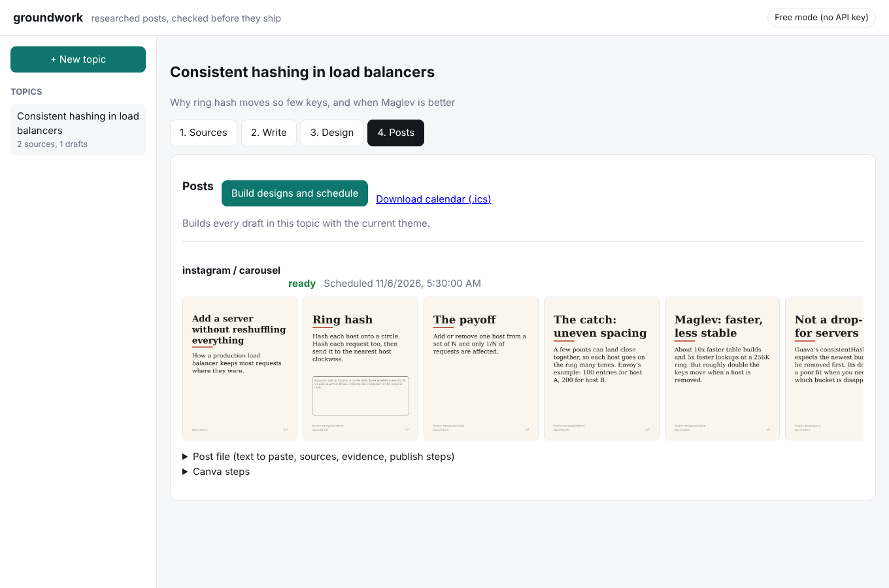
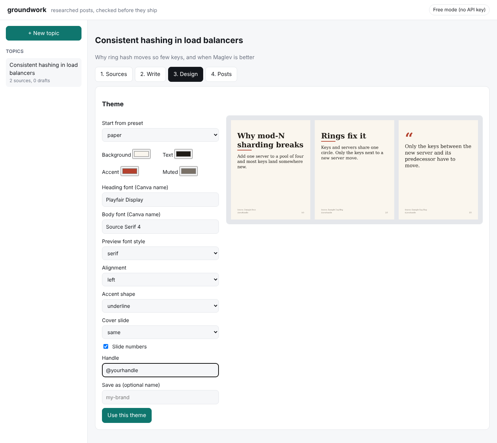
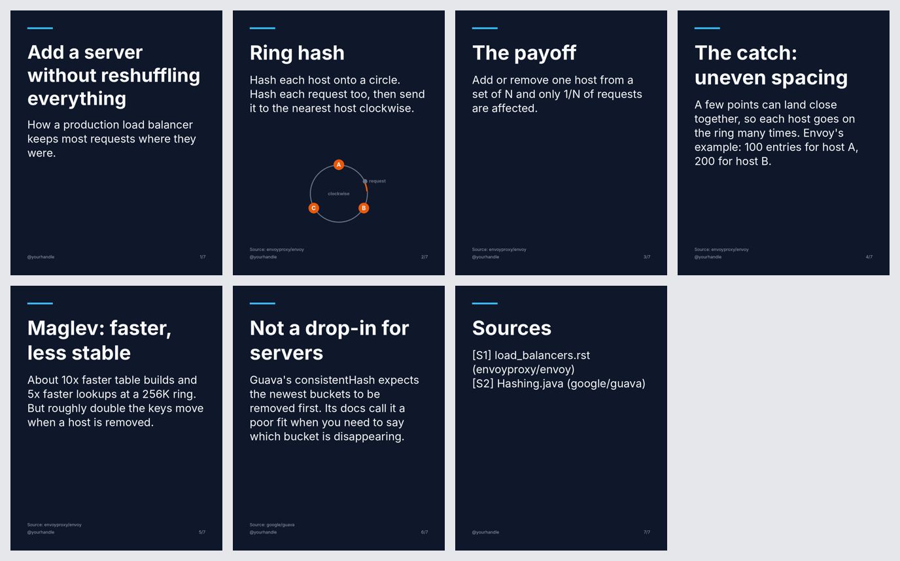

# groundwork

[](https://github.com/OjalSingh/groundwork/actions/workflows/ci.yml)

A research-first content pipeline for **Substack, LinkedIn, Instagram and X**. Give it a
topic. It collects real sources, gets a draft written for each platform, and then
**checks every factual claim against the fetched source text** before anything is scheduled.
Ready posts come out as rendered slides, a step-by-step Canva recipe and a calendar file.

The goal is posts a careful expert would sign, not volume.



## The problem it solves

AI-written posts fail in two ways: they invent facts, and they sound like every other AI
post. Asking a model to "be accurate" does not fix either. groundwork moves both checks out
of the model and into plain code that you can read and test:

- A claim only passes if a **word-for-word quote** from a page we downloaded backs it.
- A post only passes if it clears a **rule-based slop linter** and the platform's limits.
- A post that cannot pass is **never scheduled**. It is flagged for a human.

## How it works

```
topic ──► research ──► write ──► ground + lint ──► revise (≤2) ──► design ──► schedule
           │             │            │                               │           │
   Wikipedia, arXiv,  any writer  quotes must be      failures go     PNG/PDF   .ics + .csv
   HN, RSS, seed URLs (see below) verbatim; numbers   back to the     + Canva   per-platform
   + Claude web search            must be quoted;     writer with     steps     windows
                                  slop rules          exact reasons
```

1. **Research** (`research/`). Collectors find URLs; `fetch.py` downloads each page, strips
   it to text and stores it with an id (`S1`, `S2`, ...). Pages with too little text are
   dropped. No usable sources means no posts.
2. **Write** (`llm/`, `manual.py`). The writer receives the numbered sources, the platform
   rules and your voice notes, and returns a structured `Draft`: hook, parts, CTA, and a
   list of claims, each with a source id and a verbatim quote.
3. **Check** (`grounding.py`, `lint.py`). No model involved. See the next section.
4. **Revise** (`pipeline.py`). Failures go back to the writer with the exact reasons, up to
   twice. Still failing means `needs_review`, and the post is not scheduled.
5. **Design** (`design/`). Slides are drawn with Pillow in your theme, and each design gets a
   Canva guide with sizes, colours, fonts, positions and export settings. Slides that need a
   diagram or photo are listed in `needs_input.md` so you can attach your own image.
6. **Schedule** (`schedule.py`). Each ready post gets the next free slot in that platform's
   posting windows, in your time zone, written to `schedule.ics` and `schedule.csv`.

It does not publish for you. Each post file ends with the exact steps for that platform.

## What the checks actually do

| Check | Rule | Where |
|---|---|---|
| Quote exists | The quote must occur in the cited source text after normalising curly quotes and whitespace. A fuzzy match (0.9 longest-match) tolerates a dropped comma; `...` allows elisions. Paraphrase fails. | `grounding.py` |
| Numbers are backed | Any figure in the post (`80%`, `120ms`, `2024`) must appear inside a verified quote. Thread counters and small counts are ignored. | `grounding.py` |
| Weak support | A claim whose words barely overlap its quote gets a warning. This is lexical only, so it cannot judge meaning (see limits). | `grounding.py` |
| Slop | Filler openers, buzzwords, unnamed authority ("studies show"), engagement bait, "it's not X, it's Y", fake suspense, em-dash/emoji/exclamation counts. Projects can add banned words. | `lint.py` |
| Platform limits | Character counts, part counts, hashtag caps, slide counts, alt text. Read from YAML. | `platforms/` |

## Ways to run it

| Mode | Needs | Writer |
|---|---|---|
| **Local app** (`groundwork ui`) | nothing, or an API key for one-click writing | free chatbot or Claude |
| **Free mode** (`prompt` / `import`) | nothing | any chatbot you paste into |
| **Claude** (`run`) | `ANTHROPIC_API_KEY`, API credit | Claude with web search and structured output |
| **Bring your own drafts** (`--drafts`) | nothing | you |
| **Offline** (`--offline`) | nothing | extractive; for testing the pipeline only |

The checks, design and scheduling are identical in every mode. That is the point: the
writer is swappable, the quality gate is not.

## Tools and design decisions

| Piece | Choice | Why |
|---|---|---|
| Language | Python 3.10+, src layout | Runs on Windows, macOS and Linux (all in CI) |
| Data models | Pydantic v2 | One validated `Draft` schema shared by every writer |
| CLI | Click | Small surface, easy to test |
| Local UI | Flask + plain HTML/JS/CSS | No build step, no database, binds to 127.0.0.1 only |
| HTTP | httpx | Page fetching and collectors |
| Images | Pillow | Deterministic slide rendering; fonts fall back by platform |
| Config | YAML (platform templates, themes, project config) | Add a platform or theme without touching code |
| LLM | Anthropic SDK (optional extra) | `messages.parse` returns a validated `Draft`; adaptive thinking; refusal fallback enabled |
| Tests | pytest, ruff | 69 tests, no network |
| CI | GitHub Actions | Ubuntu, Windows, macOS; ruff, pytest and an offline end-to-end run |

Decisions worth knowing about:

- **Claude finds URLs; our code fetches them.** The web-search collector only harvests URLs.
  Grounding always runs against page text we downloaded, never a model's summary.
- **Quotes are verified by code, not by a second model.** It is cheap, deterministic and
  auditable. The cost is that it checks that the words exist, not that they mean what the
  post says.
- **Writers are an interface.** `ClaudeWriter`, `OfflineWriter`, `FileWriter` (your drafts)
  and `StaticWriter` (pasted chatbot replies) all return the same `Draft`.
- **Revisions are append-only.** The revise turn resends the previous assistant turn
  unchanged and adds the findings, which keeps the prompt cache warm.
- **Platforms and themes are data.** Limits, citation style, slide counts, posting windows,
  colours and fonts live in YAML.
- **Readable themes.** The wizard warns when text, muted text, accent or inverted-cover
  contrast falls below WCAG ratios.

## Project layout

```
src/groundwork/
  research/    collectors (Wikipedia, arXiv, HN, RSS, URL), page fetch and cleaning, source store
  llm/         Claude writer, offline writer, file writer
  platforms/   registry + YAML templates (x, linkedin, instagram, substack)
  design/      theme model + presets, slide renderer, Canva guide, interactive wizard
  ui/          Flask app and static front end
  grounding.py lint.py schedule.py pipeline.py manual.py output.py models.py config.py cli.py
tests/         one file per area; fixtures use synthetic sources
.github/workflows/  ci.yml (matrix), live-run.yml (manual live run with a repo secret)
```

## Known limits

Stated plainly, because a reviewer will find them anyway.

- **A verbatim quote is not proof of a correct claim.** The checks guarantee the quote is in
  the source, not that the claim is a fair reading of it. A model judge for claim support is
  on the roadmap. Until then, read the "Claims and evidence" table in each post.
- **The Claude writer has only been tested against a fake client.** The development
  environment had no API key, so the first live run is the real test.
- **Web collectors were mocked in development.** Wikipedia, arXiv and Hacker News were
  blocked in the build sandbox; the demo used seed URLs instead.
- **No PDF reading yet.** PDF links are skipped, so papers must come via an HTML page.
- **No auto-publishing.** Instagram needs a Business account and the Graph API; Substack has
  no posting API.
- **Posting windows are placeholders** until you replace them with your own analytics.

## Quick start

```bash
pip install -e '.[claude]'          # or '.[dev]' to run tests
export ANTHROPIC_API_KEY=...         # or `ant auth login`

groundwork platforms
groundwork run "consistent hashing" \
  -p x:thread -p linkedin:carousel -p instagram:carousel -p substack:article \
  --brief "Why mod-N sharding breaks when you add a node, and what rings fix" \
  --url https://en.wikipedia.org/wiki/Consistent_hashing
```

No key? `--offline` skips web search and uses an extractive writer that builds posts out
of source sentences. It is for testing the pipeline, not for publishing.

Two-step flow if you want to vet sources first:

```bash
groundwork research "consistent hashing" -o sources.json   # read the bibliography
groundwork run "consistent hashing" -p x --sources sources.json
```

After hand-editing a post's JSON, re-check it:

```bash
groundwork check runs/<run>/posts/<post>.json runs/<run>/sources.json
groundwork lint my-draft.txt
```

## What a run produces

```
runs/2026-11-03-consistent-hashing/
  report.md            status, errors/warnings, revisions, slot per post
  sources.json         every fetched source with its text
  bibliography.md
  posts/<id>.md        copy-paste text, sources block, claims-and-evidence table,
                       review notes, and how-to-publish steps for that platform
  posts/<id>.json      the structured draft (edit, then `groundwork check`)
  designs/<id>-NN.png  rendered slides; LinkedIn carousels also get <id>.pdf
  canva/<id>.md        step-by-step Canva rebuild: canvas size, colours, fonts,
                       positions, per-page text, visuals to add, export settings
  schedule.ics         import into Google Calendar / Outlook / Apple Calendar
  schedule.csv
```

When a slide needs something text rendering can't do (a diagram, an icon, a photo), the
writer fills `visual` with a concrete description. The PNG gets a labelled placeholder
and the Canva guide spells out how to build it.

## Design: themes, questions and your own images

Six presets ship in `src/groundwork/design/presets/`: `midnight`, `paper`, `terracotta`,
`forest`, `mono`, `sunrise`. A theme is colours, fonts (the names Canva should use),
alignment, accent shape (bar, underline, block, none), an optional inverted cover slide,
slide counter, handle and logo.

```bash
groundwork theme list
groundwork theme preview paper --set accent=#0F766E        # 3 sample slides -> theme-preview.png
groundwork theme save brand --from paper --set handle=@me   # writes themes/brand.yaml, makes it active
groundwork design                                           # interactive: pick, preview, tweak, save
groundwork run "topic" -p instagram:carousel --theme forest # one-off theme
groundwork run "topic" -p instagram:carousel --ask          # asks design questions, then asks for
                                                            # an image for any slide that needs one
```



Example output, Instagram carousel in the `midnight` theme:



The wizard checks readability as you go (text, muted text, accent and inverted-cover
contrast) and warns before you save an unreadable theme. Your own presets are YAML files in
`themes_dir`, same format as the built-ins.

When a slide needs a diagram, icon or photo the writer describes it. The run writes
`needs_input.md`; supply your own file and re-render:

```bash
groundwork attach runs/<run>/posts/<post>.json --slide 3 --image ring-diagram.png
groundwork render runs/<run>/posts/<post>.json runs/<run>/sources.json [--theme paper]
```

## The local web UI

```bash
groundwork ui        # opens http://127.0.0.1:8765 (localhost only)
```

Four tabs per topic: **Sources** (paste links, see what was fetched, drop weak ones),
**Write** (copy the prompt for any chatbot and paste the reply back, or one click with a
Claude API key; check results and a ready-to-paste fix message appear inline, and you can
upload images for slides that need them), **Design** (presets, colours, fonts, layout with a
live preview), **Posts** (build, slide gallery, copy-paste text, Canva steps, calendar
download). Everything is saved under `./workspace/<topic>/`, so the CLI can read it too.

## Free mode: any chatbot as the writer

No API key or credits needed. The checks, designs and scheduling are identical.

```bash
groundwork prompt "how DNS caching works" -p x:thread -p linkedin:post \
  --url https://example.com/good-source --url https://example.com/another
# -> manual/prompt-x-thread.md, manual/prompt-linkedin-post.md, manual/sources.json
# paste each prompt into a chatbot (free Claude chat, Gemini, ChatGPT), save each reply as a text file
groundwork import reply-x.txt reply-li.txt --topic "how DNS caching works" \
  --sources manual/sources.json [--theme paper]
```

If a post fails a check, `import` writes `posts/fix-<id>.md`. Paste it into the same chat,
save the new reply, and import again. Seed it with `--url` links: free mode has no web search.

## Bring your own drafts

Wrote the posts yourself, or want another tool to? `--drafts drafts.json` (keyed by
`platform:format`) skips the model and runs your text through the same grounding, slop
checks, design and scheduling.

## Platform templates are data

Each platform is a YAML file in `src/groundwork/platforms/templates/`: formats, part
counts, character limits, hashtag caps, how to cite (last tweet, first comment, last
slide, footnotes), design size and slide counts, writing guidance, and posting windows.
Put your own YAML in a `templates_dir` to override a platform completely or add a new
one (Threads, Bluesky, YouTube community posts) without touching code.

Default posting windows are placeholders. Replace them with times from your own
analytics.

## Configuration

Copy `groundwork.example.yaml` to `groundwork.yaml`. It sets voice, timezone, which
collectors and RSS feeds to use, extra banned words, model and effort, revision count,
and the visual theme (colours, fonts, handle).

## Development

```bash
pip install -e '.[dev]'
ruff check . && pytest -q
```

Tests cover grounding (verbatim, paraphrase, elision, unbacked numbers), the slop
linter, template loading and overrides, scheduling (windows, daily caps, time zones,
ICS escaping), collectors (HTML extraction, arXiv/RSS/Atom parsing, mocked Wikipedia),
the Claude writer (fake client), themes and contrast warnings, free-mode import, the web UI API,
and full offline runs including the revise-until-grounded loop.

## Roadmap

- Direct publishing for X (API v2) and LinkedIn (Posts API), behind a `--publish` flag.
  Instagram needs a Business account and the Graph API; Substack has no public posting
  API, so it stays copy-paste.
- An LLM judge pass for "does this quote actually support this claim" on top of the
  lexical overlap warning.
- PDF text extraction for papers (PDF links are skipped today).
- Per-platform style presets once the content requirements are final.

MIT licensed.
